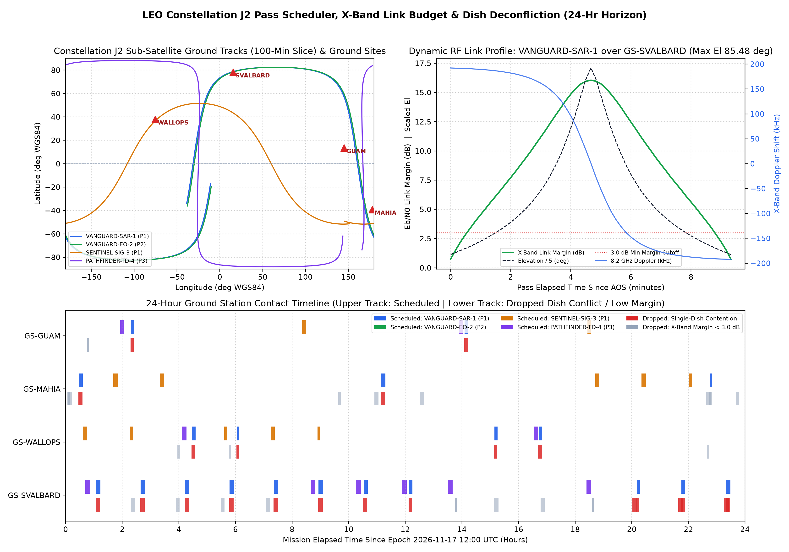

# LEO Constellation Pass & X-Band RF Link Scheduler (`leo-pass-link-scheduler`)


## Overview
`leo-pass-link-scheduler` is an end-to-end **Python** and **SQL** mission operations and astrodynamics tool that automates 24-hour ground-station access calculation, 8.2 GHz X-band downlink closure analysis, and single-dish antenna deconfliction for a multi-satellite Low Earth Orbit (LEO) constellation.

Designed around realistic spacecraft commissioning and overhead ISR tip-and-cue operations, the pipeline models a co-planar SAR/EO tandem formation (`VANGUARD-SAR-1` and `VANGUARD-EO-2`), a mid-inclination RF payload (`SENTINEL-SIG-3`), and a polar CubeSat (`PATHFINDER-TD-4`) communicating across four global tracking sites (Svalbard, Wallops, Mahia, and Guam).

> **OPSEC & Classification Notice:** All NORAD Two-Line Elements (TLEs), spacecraft EIRP specifications, ground-terminal $G/T$ figures, and contact schedules are **100% synthetic and unclassified**.

## Engineering Capabilities
1. **NORAD 3LE Verification & Secular $J_2$ Orbit Propagator (`src/orbit_link_propagator.py`):**
   * Enforces 69-character Modulo-10 checksum verification on raw TLE inputs.
   * Propagates orbits across a 24-hour horizon using vectorized Newton-Raphson Kepler solvers coupled with WGS84 secular nodal regression ($\dot{\Omega}_{J_2}$) and apsidal precession ($\dot{\omega}_{J_2}$), rotating ECI $\to$ ECEF via Greenwich Mean Sidereal Time ($\theta_{\text{GMST}}$) into topocentric South-East-Zenith ($\text{SEZ}$) coordinates.
2. **Dynamic 8.2 GHz X-Band Link Budget & Doppler Modeling:**
   * Computes time-varying slant range, carrier Doppler shift ($\Delta f_d$), free-space path loss ($\text{FSPL}$), cosecant atmospheric attenuation, and $E_b/N_0$ link margin at 150 Mbps, rejecting passes whose peak margin falls below a 3.0 dB safety threshold.
3. **SQLite Dish Contention Detection & Slew-Aware Deconfliction (`src/pass_deconfliction_sql.py`):**
   * Resolves simultaneous pass overlaps (such as tandem SAR/EO passes over Svalbard) via priority-tier and data-volume greedy scheduling while enforcing a 60-second antenna slew/re-lock turnaround buffer between consecutive contacts.
4. **3-Panel Mission Timeline & 3D Google Earth Pro Export (`src/visualize_and_export.py`):**
   * Outputs a high-DPI dashboard (`leo_mission_schedule_analysis.png`), a normalized schedule CSV, and a 3D `absolute`-altitude orbital KML (`leo_orbital_tracks_and_stations.kml`).

## Mission Dashboard Preview


## Quickstart
```bash
pip install -r requirements.txt
python run_scheduler.py